# ER-diagram – Matchbörsen

Genererat från schemat i `src/server/infra/db.ts`. Heldragna linjer är riktiga
främmande nycklar (`REFERENCES`). Streckade linjer är logiska kopplingar som bara
finns som ID-kolumner utan `REFERENCES`.

```mermaid
erDiagram
    users {
        TEXT id PK
        TEXT role "TEAM_LEADER | OFFICE | ADMIN"
        TEXT name
        TEXT email UK
        TEXT google_subject UK
        TEXT created_at
    }

    sessions {
        TEXT token PK
        TEXT user_id FK
        TEXT expires_at
    }

    teams {
        TEXT id PK
        TEXT name
        TEXT club_name
        INTEGER is_home_club
        INTEGER birth_year
        TEXT category "BOYS | GIRLS | MIXED"
        TEXT profile_assessed_level
        REAL profile_fair_play_average
        INTEGER profile_review_count
        INTEGER profile_visible
        TEXT created_at
    }

    team_memberships {
        TEXT id PK
        TEXT user_id FK "UK (user_id, team_id)"
        TEXT team_id FK
        TEXT approval_status "NOT_REQUIRED | PENDING | APPROVED | REJECTED"
        TEXT decided_by_user_id "logisk -> users"
        TEXT decided_at
        TEXT created_at
    }

    facilities {
        TEXT id PK
        TEXT name
        TEXT address
        INTEGER active
    }

    pitches {
        TEXT id PK
        TEXT facility_id FK
        TEXT name
        TEXT surface "ARTIFICIAL_TURF | NATURAL_TURF"
        TEXT supported_formats "JSON-array av GameFormat"
        INTEGER active
    }

    matches {
        TEXT id PK
        TEXT origin "NEW_WEEKEND_SLOT | OWN_TRAINING_SLOT"
        TEXT home_team_id FK
        TEXT home_contact "JSON LeaderContact"
        TEXT away_team_id FK "nullable"
        TEXT selected_opponent "JSON LeaderContact"
        TEXT game_format
        INTEGER birth_year
        TEXT category
        INTEGER open_to_adjacent_birth_years
        TEXT match_level
        INTEGER duration_minutes
        TEXT facility_id "logisk -> facilities"
        TEXT pitch_id "logisk -> pitches"
        TEXT facility_name "kopia"
        TEXT facility_address "kopia"
        TEXT pitch_name "kopia"
        TEXT surface "kopia"
        TEXT start_time
        TEXT end_time
        TEXT referee
        TEXT kit_color_home
        TEXT status "RESERVATION_REQUESTED | PUBLISHED | MATCH_CONFIRMED | COMPLETED | CANCELLED | EXPIRED"
        TEXT reservation_id "logisk -> reservations (Spår 1)"
        INTEGER inquiries_count
        INTEGER is_urgent
        TEXT completed_confirmed_at
        TEXT created_at
        TEXT updated_at
    }

    inquiries {
        TEXT id PK
        TEXT match_id FK
        TEXT team_id FK
        TEXT leader_user_id FK
        TEXT contact "JSON LeaderContact"
        TEXT status "ACTIVE | WITHDRAWN | SELECTED | REJECTED"
        TEXT created_at
        TEXT updated_at
    }

    reservations {
        TEXT id PK
        TEXT match_id UK "logisk -> matches"
        TEXT home_team_id FK
        TEXT requested_date "YYYY-MM-DD lokalt, lör/sön"
        TEXT time_window "lokal tid, t.ex. 10:00-13:00"
        TEXT game_format
        INTEGER birth_year
        TEXT category
        TEXT facility_id FK "nullable"
        TEXT pitch_id FK "nullable"
        TEXT facility_name "kopia"
        TEXT pitch_name "kopia"
        TEXT start_time
        TEXT end_time
        TEXT opponent "JSON från RESERVATION_ACCEPTED"
        TEXT status "REQUESTED | RESERVED | ACCEPTED | COMPLETED | REJECTED_BY_OFFICE | REVOKED_BY_DEADLINE | CANCELLED_BY_OFFICE | WITHDRAWN_BY_HOME | CLOSED_EXPIRED"
        TEXT decision_reason
        TEXT deadline_at "14-dagarsfristen i UTC"
        TEXT reserved_at
        TEXT created_at
        TEXT updated_at
    }

    fair_play_reviews {
        TEXT id PK
        TEXT match_id FK "UK (match_id, reviewing_team_id)"
        TEXT reviewing_team_id FK
        TEXT reviewed_team_id FK
        TEXT target_role "HOME | AWAY"
        INTEGER players_score
        INTEGER leaders_score
        TEXT spectators_score "1 | 2 | 3 | NOT_APPLICABLE"
        REAL total_score
        TEXT assessed_level
        TEXT status "PENDING | SUBMITTED | EXPIRED | PUBLISHED"
        TEXT deadline_at
        TEXT submitted_at
        TEXT published_at
    }

    outbox_events {
        TEXT event_id PK
        TEXT event_type
        TEXT match_id "logisk -> matches, UK (match_id, sequence)"
        INTEGER sequence
        TEXT payload
        TEXT created_at
        TEXT processed_at
    }

    processed_events {
        TEXT consumer PK
        TEXT event_id PK "logisk -> outbox_events"
        TEXT outcome
        TEXT processed_at
    }

    audit_log {
        TEXT id PK
        TEXT event_id
        TEXT user_id "logisk -> users (pseudonymt)"
        TEXT entity_type
        TEXT entity_id
        TEXT transition
        TEXT occurred_at
    }

    email_outbox {
        TEXT id PK
        TEXT to_email
        TEXT subject
        TEXT body
        INTEGER urgent
        TEXT created_at
        TEXT sent_at
    }

    reminders_sent {
        TEXT match_id PK "logisk -> matches"
        TEXT kind PK
        TEXT sent_at
    }

    %% Främmande nycklar (REFERENCES)
    users ||--o{ sessions : "har"
    users ||--o{ team_memberships : "är medlem via"
    teams ||--o{ team_memberships : "har ledare via"
    facilities ||--o{ pitches : "har"
    teams ||--o{ matches : "är hemmalag i"
    teams |o--o{ matches : "är bortalag i"
    matches ||--o{ inquiries : "får"
    teams ||--o{ inquiries : "anmäler"
    users ||--o{ inquiries : "skickar"
    matches ||--o{ fair_play_reviews : "bedöms i"
    teams ||--o{ fair_play_reviews : "bedömer"
    teams ||--o{ fair_play_reviews : "bedöms"
    teams ||--o{ reservations : "begär helgtid"
    facilities |o--o{ reservations : "tilldelas"
    pitches |o--o{ reservations : "tilldelas"

    %% Logiska kopplingar utan REFERENCES
    users |o..o{ team_memberships : "beslutar om"
    facilities ||..o{ matches : "anläggning"
    pitches ||..o{ matches : "spelas på"
    matches ||..o{ outbox_events : "genererar"
    outbox_events ||..o{ processed_events : "behandlas som"
    users ||..o{ audit_log : "loggas"
    matches ||..o{ reminders_sent : "påminnelse"
    matches ||..o| reservations : "Spår 1 (via outbox)"
```

`email_outbox` står fristående: rader identifieras bara av mottagarens e-postadress.
